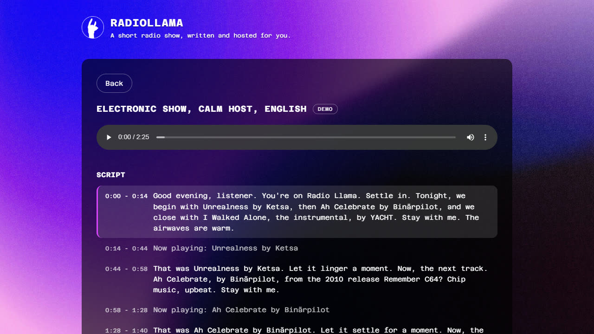

# Radio Llama

Radio Llama is a radio show made by machines. An LLM writes a radio host's script between songs, a text-to-speech voice reads it, and the result is a short radio show as one MP3. The project is being rebuilt as a clean pipeline with a web app (Phase 1). A later phase turns the host into a tool-using agent with an evaluation harness (Phase 2).

Listen: [replay page](https://marius-p1.github.io/Radio-Llama/). It plays five real shows, three in English and two in French, with no backend.

## Status

Phase 1 is done (v1.0). The pipeline, the API, the web app and the replay page run end to end. The first real shows were generated with Claude Sonnet 5.5 and ElevenLabs, in English and in French. The tests and CI use a fake LLM and a fake voice. The catalog holds 48 Creative Commons tracks; their audio is published as the `catalog-v1` release. Phase 2 is next. Tag `v0-hackathon` holds the original hackathon code.
The web app uses the hackathon look: its font, its background and its magenta buttons.
Songs play in full by default. A demo mode plays 30 second excerpts instead.
The listener chooses the show length on the create screen: 3, 5, 8 or 10 songs, each with an estimated length.
The create screen has a voice picker: the listener hears a sample of each voice of the ElevenLabs account and picks who the host sounds like, separately from the host style.

## Quickstart

### Run it with Docker

You need Docker, a Mistral or Anthropic API key, and an ElevenLabs API key.

```
cp .env.example .env
```

Fill the keys in `.env`, then:

```
docker compose up --build
```

Open http://localhost:8000. Pick a style, an energy, a host style, a voice, a language and a show length, tick Demo for a short show, press the button, and listen when the show is ready. The first start fetches the catalog audio into `catalog/audio/`. Shows are saved in `output/`, the voice cache in `cache/`.

A show has 3 songs unless you pick 5, 8 or 10. Each choice shows an estimated length: about 4 minutes per song, so about 40 minutes for 10 songs, or about 1 minute per song with Demo ticked. A longer show takes longer to generate, because the whole show is generated before it plays.

The host has two settings. The host style (calm, energetic or witty) is how the host talks. The voice is who it sounds like. The voice list is the list of voices of the ElevenLabs account behind `ELEVENLABS_API_KEY`. Add a voice to the account on elevenlabs.io and it shows up in the list after a page reload, ten minutes later at most: the backend keeps the list for ten minutes and the page loads it once. The app never adds or removes a voice. Each voice has a play button for a short sample, in the show's language when ElevenLabs has one. The samples are hosted by ElevenLabs and the browser loads them from there, so listening to one costs nothing. Each style comes with its own voice, which is used until you pick another one.

The host greets by the clock of `RADIO_TIMEZONE` (an IANA name such as `Europe/Paris`); leave it unset to use the machine's local time, which is UTC inside Docker. The host knows the date and the part of the day, not the exact hour: a show is heard later than it is written, so a spoken time would already be wrong.

With a free Jamendo client id in `.env` (`JAMENDO_CLIENT_ID`, from [devportal.jamendo.com](https://devportal.jamendo.com/)), the create screen also offers Jamendo as the music source: thirteen styles from its catalog of Creative Commons music, and an optional free-text wish ("piano for a rainy sunday") that refines the search. Jamendo audio is fetched once into `cache/jamendo/`.

With a YouTube Data API key in `.env` (`YOUTUBE_API_KEY`), the create screen also offers YouTube: famous songs, played in the embedded YouTube player between the host's breaks. There is no style to pick on YouTube. You say what you want to hear ("90s French rap, upbeat") and the LLM chooses the songs from that and the energy. To get a key: create a project in the [Google Cloud console](https://console.cloud.google.com/), enable the YouTube Data API v3 for it, then create an API key under Credentials and restrict it to that API. The free quota allows 100 searches a day and a show uses about one search per song: about 30 shows of 3 songs, or 10 shows of 10 songs. `YOUTUBE_REGION` (default `FR`) is the country whose YouTube catalog is searched.



Audio sample: [the first minute of a real English show](https://github.com/Marius-P1/Radio-Llama/releases/download/v0.5/radio-llama-sample-en.mp3) (MP3, 1 MB), attached to the v0.5 release. Electronic style, calm host, demo mode. Script by Claude Sonnet 5.5, voice by ElevenLabs. Music: [Unrealness](https://freemusicarchive.org/music/Ketsa/upbeat-street/unrealness/) by [Ketsa](https://ketsa.bandcamp.com/), from Upbeat Street, [CC BY 4.0](https://creativecommons.org/licenses/by/4.0/).

### Try the pipeline without any key

Python 3.12, `uv` and ffmpeg on your path.

```
uv sync
uv run python catalog/download.py
uv run radio-llama generate --fake --style jazz --energy calm --demo
```

You get `output/<show_id>/show.mp3` and `show.json`. The fake LLM returns a canned sentence and the fake voice is a faint hum, so the MP3 proves the pipeline, not the content. `--demo` cuts each song to 30 seconds for a fast first run; without it the show plays the full tracks, about 11 minutes with 3 tracks. `--energy` is optional: `calm`, `medium` or `upbeat`, any energy when left out. `--seed` fixes the track pick. `--tracks` sets the number of songs, 3 by default. `--voice <id>` gives the host another voice than the persona's own. The id must be one of the voice list (`GET /api/v1/voices`; with `--fake` they are `fake-voice-1` to `fake-voice-5`). An unknown id stops the command before anything is generated. With a Jamendo client id, `--source jamendo --style lounge --wish "something with a trumpet"` searches Jamendo instead of the catalog (the wish needs a real LLM). With a YouTube key, `--source youtube --wish "90s French rap, upbeat"` takes no `--style`: the wish is the whole request.

To read scripts without paying for the voice, `uv run radio-llama script --style jazz --seed 1` writes a show's text and prints it, with the shape and word count of each break. Add `--fake` to run it without any key.

Without the catalog audio, CI and the tests use the fixture catalog of test tones instead: `uv run python tests/fixtures/catalog/make_placeholder_audio.py`, then `CATALOG_PATH=tests/fixtures/catalog/catalog.json` in front of the command.

## How it works

1. Pick tracks. The pipeline samples as many tracks as the listener asked for, three by default, from the chosen style of the music source. The local catalog lists its tracks; Jamendo is searched by the style's tag and, when the listener gave one, by the wish, which one LLM call turns into Jamendo filters (tags, vocal or instrumental, lyrics language, an artist name). For YouTube there is no style: one LLM call proposes famous songs that fit the wish and the energy, two more than needed, and the backend keeps those with a video the embedded player can play. The host is told that the wish is the theme of the show. When the listener asks for an energy, tracks with that energy come first, then tracks with no energy label, then the other energies, nearest first. A seed makes the pick reproducible on the catalog.
2. Load the host. A persona (calm, energetic or witty) and the prompt files for the chosen language set the tone and the rules. The persona also names the voice the host speaks with, unless the listener picked another one.
3. Write the script. One LLM call per spoken segment: an intro, a break before each song after the first, an outro. Every call after the first receives what the host already said in the show, so openers and closers are not reused. Each break gets a shape picked by code (a one-breath hand-over, a back-announce, an aside, a longer introduction, or a story from the facts), never the same twice in a row, and its length follows the shape, from 5 to 25 seconds; the word budget comes from that length and a per-language speech rate. The intro receives the programme and teases one or two names; breaks receive the next track's album, year, tags, energy, its facts labelled artist or track, and the host notes. A Jamendo track's facts are looked up before the shapes are picked, so a track with facts can get the story; a track with none gets the other shapes. The host speaks for the station ("we") to everyone listening ("you", "vous") and knows the date and the part of the day, never the exact hour; it may mention the day or the date now and then. The system prompt asks for a mix of short and longer sentences and lists the habits of generated text the host must avoid: staged openers, contrasts nobody made, closing lines that repeat the point, groups of three, brochure words.
4. Voice the script. Each segment goes through text to speech behind a disk cache. The same text with the same voice is never synthesised twice.
5. Assemble the audio. ffmpeg fades each song in and out (and cuts it to 30 seconds in demo mode), normalises the loudness of every piece, then joins everything into one MP3. The joined file is constant bitrate, so browsers seek it exactly. A YouTube show has no MP3: only the host's segments are normalised, one file each, and the songs stay on YouTube.
6. Save and serve. `show.json` holds the script, the track list, the timings and the credits, next to `show.mp3`. The API serves both and the web app plays them. For a YouTube show the API serves each speech file on its own and the web app plays the segments in order, the songs in the embedded player.

### The trace

Every show keeps a record of what the host was told. It sits in `output/<show_id>/trace/`, one JSON Lines file per remote service, one line per call. `radio-llama script` has no show folder, so it writes its trace to `output/scripts/<show_id>/` and prints the path.

- `llm.jsonl`: each call to the model, with a label (`intro`, `transition before <title> (<shape>)`, `outro`, `wish`), the provider and model, the full messages sent, the answer, the token counts.
- `tts.jsonl`: each spoken segment, with the text, the voice, whether the cache answered, the file path and its size. Never the audio.
- `jamendo.jsonl`: each Jamendo request with its parameters and the full JSON reply, and each audio download with its URL, path and size. The client id is redacted, in the query and in the audio URLs the reply echoes.
- `youtube.jsonl`: each YouTube search and videos request with its parameters and the full JSON reply, and each song answered from the 30-day cache with the video it gave. The API key is redacted.
- `musicbrainz.jsonl`, `wikidata.jsonl`, `wikipedia.jsonl`: each facts request with its URL, parameters, HTTP status and full reply. A MusicBrainz retry is a second line.
- `facts.jsonl`: facts answers served from the memory or disk cache, with the facts returned.

Every line starts with the UTC time, the latency in seconds and the error text when the call failed. A line that cannot be written is logged and dropped; the trace never fails a show. The trace is always on, the API and the player never show it, and the replay export leaves it behind. Reading a strange line in a show starts here: find the segment in `llm.jsonl` and read what the host was given.

### Layout

- `src/radio_llama/`: the Python package.
  - `config.py`: settings from the environment and `.env`.
  - `models.py`: `Track`, `Fact`, `Persona`, `ShowConfig`, `Segment`, `Show`.
  - `music/`: the `MusicSource` interface, the local catalog, the Jamendo source and the YouTube source.
  - `facts.py`: facts for Jamendo and YouTube artists from MusicBrainz, Wikidata and Wikipedia.
  - `llm/`: the `LLMClient` interface, the Mistral and Anthropic adapters, the fake.
  - `script/`: prompt loading, word budgets, break shapes, the clock line, the script writer, the wish mapper, the playlist proposer.
  - `voice/`: the `TextToSpeech` interface, ElevenLabs, the disk cache, the fake. Also the `VoiceList` interface: the voices of the ElevenLabs account, and a few made-up ones for the fake.
  - `audio/`: ffmpeg calls and the show assembler.
  - `generator/`: the `ShowGenerator` interface, the pipeline, the run lifecycle.
  - `api/`: the FastAPI app, the `/api/v1` routes, the background jobs.
  - `cli.py`: the `radio-llama` command.
  - `storage.py`: reading and writing `show.json`.
  - `trace.py`: the per-show record of every API call.
- `prompts/en/` and `prompts/fr/`: system, intro, transition, outro, wish and playlist prompts, plus the personas and the break shapes, one folder per language.
- `catalog/`: `catalog.json`, the download script and the checksums. See [catalog/README.md](catalog/README.md).
- `frontend/`: the React web app. See [frontend/README.md](frontend/README.md).
- `tests/`: pytest, fakes only. `tests/fixtures/catalog/` holds the placeholder catalog of test tones that CI plays; `tests/fixtures/jamendo/`, `tests/fixtures/youtube/` and `tests/fixtures/facts/` hold recorded Jamendo, YouTube, MusicBrainz, Wikidata and Wikipedia replies.

## Design notes

- Music comes from a local catalog of Creative Commons tracks, not from Spotify. Spotify's terms forbid capturing audio and feeding its content to AI models, and the hackathon's recommendation endpoint is closed to new apps. A local catalog also gives the same inputs on every run, which the Phase 2 evaluation needs. Every fact in the catalog has a source URL and a quote.
- Radio Llama is a non-commercial demo. Any Creative Commons license that allows redistribution with attribution is accepted, including non-commercial (NC) ones; the hand-written catalog leaves ND tracks out. A show is a collection of tracks, not an adaptation: each track keeps its own license, and every show credits each track with its artist, album, license and source links.
- Jamendo is the first online music source. It hosts Creative Commons music, answers plain HTTP requests with JSON, and gives a free client id for non-commercial apps. A Jamendo show uses the track's own license, whatever Creative Commons variant it is, and its audio is fetched through the track's stream URL into `cache/jamendo/`. The host's facts for a Jamendo artist come from the description the artist wrote on their Jamendo page, then from MusicBrainz and Wikipedia, five facts at most. The artist is searched on MusicBrainz by name, and the best hit counts only when its name or one of its aliases is the same name. Its MusicBrainz entry gives one sentence (solo artist or group, country, start year) and its Wikidata link leads to the Wikipedia page, in the show's language first, whose first two sentences are quoted. There is no name search on Wikipedia. Each fact keeps its page as the source, and the player lists those pages under each track's credits. Results, misses included, are cached in `cache/facts/`. A failed lookup never fails the show: a MusicBrainz failure gives no facts, a Wikipedia failure keeps the MusicBrainz sentence. MusicBrainz calls are kept a second apart, as its rules ask. Spotify and SoundCloud were looked at: see the Limitations.
- YouTube is the route to famous songs. YouTube's own search by genre returns mixes and compilations, so the LLM proposes the songs (artist and title, two more than the show needs) and the backend verifies each one with the YouTube Data API: one search per song, then one videos call that checks the video is public, embeddable, not live, not age restricted, not blocked in the region, and lasts between one and twelve minutes. The artist's own channel wins when there is one. Proposing songs is selection, not an on-air fact: the host's facts still come from MusicBrainz and Wikipedia. The search quota is 100 searches a day per Google Cloud project, so each song's answer is cached for 30 days in `cache/youtube/`, the longest YouTube's policies allow, and a repeated song costs no search. The songs are never downloaded: a YouTube show has no `show.mp3`. The web app plays the host's segments from their own files and each song in the official embedded player, which stays visible as the policies require. Ads may play for listeners without YouTube Premium. The app itself stores nothing about who listens.
- The LLM is reached through my own thin interface, with Mistral and Anthropic adapters built on the official SDKs. No LiteLLM, no agent framework. I can explain every line, and Phase 2 compares providers and their tool-call formats, which a framework would hide.
- Prompts are files, one folder per language, English and French. The two languages declare the same placeholders and a test checks it. Quality is evaluated in English only.
- Text to speech sits behind a disk cache keyed by a hash of the text, the voice id, the model id and the voice settings. The filesystem is the index. Running the same show twice makes no second ElevenLabs call.
- The host's style and its voice are two choices. A persona says how the host talks and names a default voice. The listener can pick any voice of the ElevenLabs account instead. The backend reads the account's voices with the official SDK and serves them on `GET /api/v1/voices`. That is its own route, so a slow or failing ElevenLabs call never holds back the rest of the create screen: without the list, the show uses the style's own voice. The list is kept in memory for ten minutes. The call to ElevenLabs gives up after ten seconds and is not retried, because a person is waiting. When it fails, the error shown by the page and by the CLI is one short sentence with the HTTP status. With no answer at all (a timeout, no network) the sentence has no status. ElevenLabs' full answer is written as a warning to stderr, which is the terminal for the CLI and the server log for the API. A show stores the picked voice's id and name in `show.json`, so the player can name the voice later without asking ElevenLabs. The sample links go to the browser as ElevenLabs gives them. Some are signed links on an ElevenLabs address: they play without the API key, and the key itself never goes to the browser. With the fake voice the list is five made-up voices with no sample.
- Loudness normalisation is single-pass. A two-pass run doubles the runtime for a gain in accuracy this project does not need.
- The API is job-based: create a show, poll its status, fetch the audio. One show generates at a time. Shows are files in `output/`. No database, no task queue. One user at a time is the real use case.
- The show length is a number of songs, not a target in minutes. It maps onto what the pipeline already does and it is exact; the length in minutes shown next to each choice is an estimate. The API accepts 1 to 10 songs, 3 by default. The smallest style of the local catalog has 11 tracks, so a catalog show of 10 songs can always be filled, and the bound keeps the wait and the YouTube searches reasonable. The create request is not checked against the source: a count the source cannot fill gives a failed show with a message that says how many tracks it has. The CLI's `--tracks` has no upper bound.
- The create request has a `generator` field that only accepts `pipeline` today. Phase 2 adds `agent` next to it, so the pipeline stays as the baseline the agent is compared against.
- The web app is a separate React and Vite app. Its API types are generated from the backend's OpenAPI schema, so a breaking backend change fails the frontend build.
- The public demo is a static replay page on GitHub Pages, not a live deployment. It costs nothing, cannot be abused, and reuses the real frontend in a read-only mode.
- The Anthropic adapter accepts `temperature` but ignores it, because the Anthropic API no longer supports the parameter. Keeping it in the shared signature means every client is called the same way. Mistral still honours it.

## Development

Python 3.12 with `uv`. `uv sync` creates `.venv/`.

Run the checks:

```
uv run ruff check .
uv run ruff format --check .
uv run pytest
```

Tests never call a paid API. The Python side is linted and formatted with ruff, the frontend is linted with oxlint. To contribute, read [CONTRIBUTING.md](CONTRIBUTING.md).

### Dev mode

Terminal 1, the API on port 8000 with reload:

```
uv run radio-llama serve --reload
```

Terminal 2, Vite on port 5173, which proxies `/api` to the backend:

```
cd frontend && npm install && npm run dev
```

After an API change, run `uv run radio-llama export-openapi` and then `npm run generate-types` in `frontend/`. CI fails if either generated file is stale.

## Limitations

- French generation runs end to end, but its quality is not evaluated. Only English is.
- The host knows only the facts written by hand in the catalog or, for a Jamendo track, the artist's own Jamendo description and what MusicBrainz and Wikipedia say about the artist. The prompt tells it to use nothing else. It does not search the web.
- Most Jamendo artists are not on MusicBrainz, so most Jamendo tracks still get few facts. The match is by name only: an unknown Jamendo artist who shares a name with a known artist would get the known artist's facts. The facts are about the artist, never the song: the first release date MusicBrainz lists for a Creative Commons song is often a late compilation. Cached facts never expire.
- Jamendo shows are not reproducible: a search returns whatever is popular that month, and the catalog stays the source for the evaluation. The style to tag mapping and the wish filters have been checked against the API documentation, not yet against many live searches.
- On Jamendo, a wish that matches fewer tracks than the show needs is completed with other tracks of the style. The pick does not prefer the tracks that match the wish, so a long show can play few of them.
- Famous music comes through YouTube embeds only. Spotify's developer rules since February 2026 need a Premium owner, cap an app at five users and forbid capturing audio. SoundCloud only registers apps for paid Artist Pro accounts.
- A YouTube show has no MP3. It exports to the replay page like the others, as its speech files plus the video ids, and the songs play in the YouTube player there too. Publishing new shows of any kind needs a new `v*` release with its `replay-shows.zip`. The free quota is 100 searches a day. A video can stop being playable after the show is made; the player has to skip it. Shows older than 30 days keep video ids that the policies say to refresh. The LLM proposes the songs, so an unusual wish can get songs that only loosely fit, and the songs of two shows with the same choices are often the same. The LLM proposes two songs more than the show needs, so a 10 song show survives only two songs without a playable video out of twelve, a thinner margin than a 3 song show has, and a failed try can spend up to 12 of the 100 daily searches.
- The show lengths on the create screen are estimates, 4 minutes per song. Jamendo and YouTube songs can be much longer.
- On the local catalog a long show cannot follow the Energy choice closely: a style has few tracks of each energy (lofi has one upbeat track), so the pick is completed with the nearest energies.
- Segment timing is estimated from a word count and a fixed speech rate, not measured from the speech.
- Whether the host repeats itself less is judged by reading scripts, not by a metric yet. The Phase 2 harness will measure it.
- One show generates at a time. A second request waits.
- Only seven real shows have been generated so far, all with Claude. The Mistral adapter is tested against recorded responses, not the live API.
- The energy labels in the catalog are the curator's; all jazz tracks have none.
- French shows receive the host notes in English.
- The Anthropic adapter ignores `temperature`.
- The web app has not been tested with a non-technical person yet.
- The web app has no deep links. Reloading the page returns to the first screen.

## Origins

Radio Llama won first prize at SHIFT Nantes 2024, a 48 hour hackathon. The team of 5: Amine Saboni, Léo Joly-Jehenne, Romain Jolidon, Tak Castel, Marius Pain. The original repo is at https://github.com/SaboniAmine/radio_llama. Marius's part was the script and voice generation (LLM prompts and ElevenLabs).

The hackathon tree is preserved at tag `v0-hackathon`. The copyrighted music files, caches and a hardcoded database URL were removed. Per-commit history stays in the original repo.

`frontend/assets/img/bg.jpg` in that snapshot comes from the hackathon's UI theme. Its original source is not recorded.

## Roadmap

- Phase 1 (this): the template pipeline, the API, the web app, the replay page.
- Phase 2: a tool-using agent as a second generator, an evaluation harness, a pipeline versus agent comparison, and an OpenAI-compatible adapter for local models.

## License

MIT, see [LICENSE](LICENSE). Hackathon code copyright the team, later work copyright Marius Pain.
