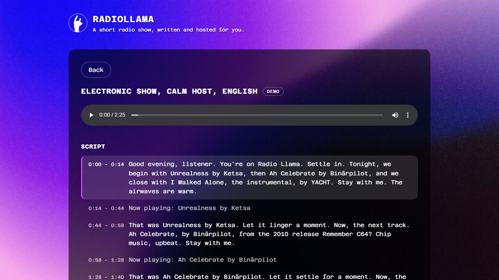

# Radio Llama

Radio Llama is a radio show made by machines. An LLM writes a radio host's script between songs, a text-to-speech voice reads it, and the result is a short radio show as one MP3. The project is being rebuilt as a clean pipeline with a web app (Phase 1). A later phase turns the host into a tool-using agent with an evaluation harness (Phase 2).

Listen: [replay page](https://marius-p1.github.io/Radio-Llama/). It plays five real shows, three in English and two in French, with no backend.

## Status

Phase 1 is done (v1.0). The pipeline, the API, the web app and the replay page run end to end. The first real shows were generated with Claude Sonnet 5.5 and ElevenLabs, in English and in French. The tests and CI use a fake LLM and a fake voice. The catalog holds 48 Creative Commons tracks; their audio is published as the `catalog-v1` release. Phase 2 is next. Tag `v0-hackathon` holds the original hackathon code.
The web app uses the hackathon look: its font, its background and its magenta buttons.
Songs play in full by default. A demo mode plays 30 second excerpts instead.

## Quickstart

### Run it with Docker

You need Docker, a Mistral or Anthropic API key, and an ElevenLabs API key.

```
cp .env.example .env
```

Fill the keys in `.env`, then:

```
docker compose up --build
```

Open http://localhost:8000. Pick a style, an energy, a host and a language, tick Demo for a short show, press the button, and listen when the show is ready. The first start fetches the catalog audio into `catalog/audio/`. Shows are saved in `output/`, the voice cache in `cache/`.

The host greets by the clock of `RADIO_TIMEZONE` (an IANA name such as `Europe/Paris`); leave it unset to use the machine's local time, which is UTC inside Docker. The host knows the date and the part of the day, not the exact hour: a show is heard later than it is written, so a spoken time would already be wrong.

With a free Jamendo client id in `.env` (`JAMENDO_CLIENT_ID`, from [devportal.jamendo.com](https://devportal.jamendo.com/)), the create screen also offers Jamendo as the music source: thirteen styles from its catalog of Creative Commons music, and an optional free-text wish ("piano for a rainy sunday") that refines the search. Jamendo audio is fetched once into `cache/jamendo/`.



Audio sample: [the first minute of a real English show](https://github.com/Marius-P1/Radio-Llama/releases/download/v0.5/radio-llama-sample-en.mp3) (MP3, 1 MB), attached to the v0.5 release. Electronic style, calm host, demo mode. Script by Claude Sonnet 5.5, voice by ElevenLabs. Music: [Unrealness](https://freemusicarchive.org/music/Ketsa/upbeat-street/unrealness/) by [Ketsa](https://ketsa.bandcamp.com/), from Upbeat Street, [CC BY 4.0](https://creativecommons.org/licenses/by/4.0/).

### Try the pipeline without any key

Python 3.12, `uv` and ffmpeg on your path.

```
uv sync
uv run python catalog/download.py
uv run radio-llama generate --fake --style jazz --energy calm --demo
```

You get `output/<show_id>/show.mp3` and `show.json`. The fake LLM returns a canned sentence and the fake voice is a faint hum, so the MP3 proves the pipeline, not the content. `--demo` cuts each song to 30 seconds for a fast first run; without it the show plays the full tracks, about 11 minutes with 3 tracks. `--energy` is optional: `calm`, `medium` or `upbeat`, any energy when left out. `--seed` fixes the track pick. With a Jamendo client id, `--source jamendo --style lounge --wish "something with a trumpet"` searches Jamendo instead of the catalog (the wish needs a real LLM).

To read scripts without paying for the voice, `uv run radio-llama script --style jazz --seed 1` writes a show's text and prints it, with the shape and word count of each break. Add `--fake` to run it without any key.

Without the catalog audio, CI and the tests use the fixture catalog of test tones instead: `uv run python tests/fixtures/catalog/make_placeholder_audio.py`, then `CATALOG_PATH=tests/fixtures/catalog/catalog.json` in front of the command.

## How it works

1. Pick tracks. The pipeline samples a few tracks of the chosen style from the music source. The local catalog lists its tracks; Jamendo is searched by the style's tag and, when the listener gave one, by the wish, which one LLM call turns into Jamendo filters (tags, vocal or instrumental, lyrics language, an artist name). When the listener asks for an energy, tracks with that energy come first, then tracks with no energy label, then the other energies, nearest first. A seed makes the pick reproducible on the catalog.
2. Load the host. A persona (calm, energetic or witty) and the prompt files for the chosen language set the tone and the rules.
3. Write the script. One LLM call per spoken segment: an intro, a break before each song after the first, an outro. Every call after the first receives what the host already said in the show, so openers and closers are not reused. Each break gets a shape picked by code (a one-breath hand-over, a back-announce, an aside, a longer introduction, or a story from the facts), never the same twice in a row, and its length follows the shape, from 5 to 25 seconds; the word budget comes from that length and a per-language speech rate. The intro receives the programme and teases one or two names; breaks receive the next track's album, year, tags, energy, its facts labelled artist or track, and the host notes. The host speaks for the station ("we") to everyone listening ("you", "vous") and knows the date and the part of the day, never the exact hour. The system prompt also lists the habits of generated text the host must avoid: staged openers, contrasts nobody made, closing lines that repeat the point, groups of three, brochure words.
4. Voice the script. Each segment goes through text to speech behind a disk cache. The same text with the same voice is never synthesised twice.
5. Assemble the audio. ffmpeg fades each song in and out (and cuts it to 30 seconds in demo mode), normalises the loudness of every piece, then joins everything into one MP3.
6. Save and serve. `show.json` holds the script, the track list, the timings and the credits, next to `show.mp3`. The API serves both and the web app plays them.

### Layout

- `src/radio_llama/`: the Python package.
  - `config.py`: settings from the environment and `.env`.
  - `models.py`: `Track`, `Fact`, `Persona`, `ShowConfig`, `Segment`, `Show`.
  - `music/`: the `MusicSource` interface, the local catalog and the Jamendo source.
  - `llm/`: the `LLMClient` interface, the Mistral and Anthropic adapters, the fake.
  - `script/`: prompt loading, word budgets, break shapes, the clock line, the script writer, the wish mapper.
  - `voice/`: the `TextToSpeech` interface, ElevenLabs, the disk cache, the fake.
  - `audio/`: ffmpeg calls and the show assembler.
  - `generator/`: the `ShowGenerator` interface, the pipeline, the run lifecycle.
  - `api/`: the FastAPI app, the `/api/v1` routes, the background jobs.
  - `cli.py`: the `radio-llama` command.
  - `storage.py`: reading and writing `show.json`.
- `prompts/en/` and `prompts/fr/`: system, intro, transition, outro and wish prompts, plus the personas and the break shapes, one folder per language.
- `catalog/`: `catalog.json`, the download script and the checksums. See [catalog/README.md](catalog/README.md).
- `frontend/`: the React web app. See [frontend/README.md](frontend/README.md).
- `tests/`: pytest, fakes only. `tests/fixtures/catalog/` holds the placeholder catalog of test tones that CI plays; `tests/fixtures/jamendo/` holds recorded Jamendo replies.

## Design notes

- Music comes from a local catalog of Creative Commons tracks, not from Spotify. Spotify's terms forbid capturing audio and feeding its content to AI models, and the hackathon's recommendation endpoint is closed to new apps. A local catalog also gives the same inputs on every run, which the Phase 2 evaluation needs. Every fact in the catalog has a source URL and a quote.
- Radio Llama is a non-commercial demo. Any Creative Commons license that allows redistribution with attribution is accepted, including non-commercial (NC) ones; the hand-written catalog leaves ND tracks out. A show is a collection of tracks, not an adaptation: each track keeps its own license, and every show credits each track with its artist, album, license and source links.
- Jamendo is the first online music source. It hosts Creative Commons music, answers plain HTTP requests with JSON, and gives a free client id for non-commercial apps. A Jamendo show uses the track's own license, whatever Creative Commons variant it is, and its audio is fetched through the track's stream URL into `cache/jamendo/`. The host's facts for a Jamendo artist come from the description the artist wrote on their Jamendo page, with that page as the source. Spotify, YouTube and SoundCloud were looked at: see the Limitations.
- The LLM is reached through my own thin interface, with Mistral and Anthropic adapters built on the official SDKs. No LiteLLM, no agent framework. I can explain every line, and Phase 2 compares providers and their tool-call formats, which a framework would hide.
- Prompts are files, one folder per language, English and French. The two languages declare the same placeholders and a test checks it. Quality is evaluated in English only.
- Text to speech sits behind a disk cache keyed by a hash of the text, the voice id, the model id and the voice settings. The filesystem is the index. Running the same show twice makes no second ElevenLabs call.
- Loudness normalisation is single-pass. A two-pass run doubles the runtime for a gain in accuracy this project does not need.
- The API is job-based: create a show, poll its status, fetch the audio. One show generates at a time. Shows are files in `output/`. No database, no task queue. One user at a time is the real use case.
- The create request has a `generator` field that only accepts `pipeline` today. Phase 2 adds `agent` next to it, so the pipeline stays as the baseline the agent is compared against.
- The web app is a separate React and Vite app. Its API types are generated from the backend's OpenAPI schema, so a breaking backend change fails the frontend build.
- The public demo is a static replay page on GitHub Pages, not a live deployment. It costs nothing, cannot be abused, and reuses the real frontend in a read-only mode.
- The Anthropic adapter accepts `temperature` but ignores it, because the Anthropic API no longer supports the parameter. Keeping it in the shared signature means every client is called the same way. Mistral still honours it.

## Development

Python 3.12 with `uv`. `uv sync` creates `.venv/`.

Run the checks:

```
uv run ruff check .
uv run ruff format --check .
uv run pytest
```

Tests never call a paid API. The Python side is linted and formatted with ruff, the frontend is linted with oxlint. To contribute, read [CONTRIBUTING.md](CONTRIBUTING.md).

### Dev mode

Terminal 1, the API on port 8000 with reload:

```
uv run radio-llama serve --reload
```

Terminal 2, Vite on port 5173, which proxies `/api` to the backend:

```
cd frontend && npm install && npm run dev
```

After an API change, run `uv run radio-llama export-openapi` and then `npm run generate-types` in `frontend/`. CI fails if either generated file is stale.

## Limitations

- French generation runs end to end, but its quality is not evaluated. Only English is.
- The host knows only the facts written by hand in the catalog, or the artist's own Jamendo description for a Jamendo track, and the prompt tells it to use nothing else. It does not search the web.
- Jamendo shows are not reproducible: a search returns whatever is popular that month, and the catalog stays the source for the evaluation. The style to tag mapping and the wish filters have been checked against the API documentation, not yet against many live searches.
- No famous music yet. Spotify's developer rules since February 2026 need a Premium owner, cap an app at five users and forbid capturing audio. SoundCloud only registers apps for paid Artist Pro accounts. YouTube embeds are the planned route to famous songs.
- Segment timing is estimated from a word count and a fixed speech rate, not measured from the speech.
- Whether the host repeats itself less is judged by reading scripts, not by a metric yet. The Phase 2 harness will measure it.
- One show generates at a time. A second request waits.
- Only seven real shows have been generated so far, all with Claude. The Mistral adapter is tested against recorded responses, not the live API.
- The energy labels in the catalog are the curator's; all jazz tracks have none.
- French shows receive the host notes in English.
- The Anthropic adapter ignores `temperature`.
- The web app has not been tested with a non-technical person yet.
- The web app has no deep links. Reloading the page returns to the first screen.

## Origins

Radio Llama won first prize at SHIFT Nantes 2024, a 48 hour hackathon. The team of 5: Amine Saboni, Léo Joly-Jehenne, Romain Jolidon, Tak Castel, Marius Pain. The original repo is at https://github.com/SaboniAmine/radio_llama. Marius's part was the script and voice generation (LLM prompts and ElevenLabs).

The hackathon tree is preserved at tag `v0-hackathon`. The copyrighted music files, caches and a hardcoded database URL were removed. Per-commit history stays in the original repo.

`frontend/assets/img/bg.jpg` in that snapshot comes from the hackathon's UI theme. Its original source is not recorded.

## Roadmap

- Phase 1 (this): the template pipeline, the API, the web app, the replay page.
- Phase 2: a tool-using agent as a second generator, an evaluation harness, a pipeline versus agent comparison, and an OpenAI-compatible adapter for local models.

## License

MIT, see [LICENSE](LICENSE). Hackathon code copyright the team, later work copyright Marius Pain.
